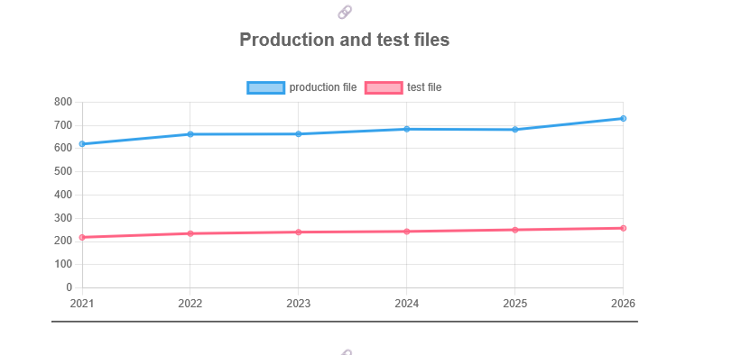

Explorando evolução de código

Neste exercício, iremos explorar a evolução de código em sistemas reais.

Iremos utilizar a ferramenta GitEvo. Essa ferramenta analisa a evolução de código em repositórios Git nas linguagens Python, JavaScript, TypeScript e Java, e gera relatórios HTML como este.

Mais exemplos de relatórios podem ser podem ser encontrados em https://github.com/andrehora/gitevo-examples.
Passo 1: Selecionar repositório a ser analisado

Selecione um repositório relevante na linguagem de sua preferência (Python, JavaScript, TypeScript ou Java). Você pode encontrar projetos interessantes nos links abaixo:

    Python: https://github.com/topics/python?l=python
    JavaScript: https://github.com/topics/javascript?l=javascript
    TypeScript: https://github.com/topics/typescript?l=typescript
    Java: https://github.com/topics/java?l=java

Passo 2: Instalar e rodar a ferramenta GitEvo

Note

Antes de instalar a ferramenta, é recomendado criar e ativar um ambiente virtual Python.

Instale a ferramenta GitEvo com o comando:

$ pip install gitevo

Execute a ferramenta no repositório selecionado utilizando o comando abaixo (ajuste conforme a linguagem do repositório). Substitua <git_url> pela URL do repositório que será analisado:

# Python
$ gitevo -r python <git_url>

# JavaScript
$ gitevo -r javascript <git_url>

# TypeScript
$ gitevo -r typescript <git_url>

# Java
$ gitevo -r java <git_url>

Por exemplo, para analisar o projeto Flask escrito em Python:

$ gitevo -r python https://github.com/pallets/flask

Note

Essa etapa pode demorar alguns minutos pois o projeto será clonado e analisado localmente.
Passo 3: Explorar o relatório de evolução de código

Após executar a ferramenta GitEvo, é gerado um relatório HTML contendo diversos gráficos sobre a evolução do código.

Abra o relatório HTML e observe com atenção os gráficos.
Passo 4: Explicar um gráfico de evolução de código

Selecione um dos gráficos de evolução e explique-o com suas palavras. Por exemplo, você pode:

    Detalhar a evolução ao longo do tempo
    Detalhar se as curvas estão de acordo com boas práticas
    Explicar grandes alterações nas curvas
    Explorar a documentação do repositório em busca de explicações para grandes alterações
    etc.

Seja criativo!
Instruções para o exercício

    Crie um fork deste repositório (mais informações sobre forks aqui).
    Adicione o relatório HTML no seu fork.
    No Moodle, submeta apenas a URL do seu fork.

1. Repositório selecionado
https://github.com/scikit-learn/scikit-learn

2. Gráfico selecionado

3. Explicação

### Análise Temporal e Comportamento das Curvas
Ao analisar o gráfico **Production and test files** (gerado pelo GitEvo entre 2021 e 2026), observa-se uma evolução altamente estável e incremental da base de código do projeto:
* **Arquivos de Produção (production file):** Apresentam um crescimento gradual e constante, subindo de cerca de 620 arquivos em 2021 para aproximadamente 730 arquivos em 2026.
* **Arquivos de Teste (test file):** Mantêm um crescimento igualmente linear e suave, evoluindo de cerca de 220 arquivos em 2021 para perto de 260 arquivos em 2026.

### Boas Práticas e Padrões Observados
* **Proporcionalidade e Manutenibilidade:** A curva de arquivos de teste acompanha em sincronismo o crescimento da base de produção. A proporção mantém-se aproximadamente constante (~1 arquivo de teste para cada 2.8 a 3 arquivos de produção), o que demonstra uma cultura madura de *Garantia de Qualidade* (QA) e integração contínua (CI).
* **Ausência de Débito Técnico Abrupto:** As curvas não apresentam picos descontrolados nem quedas acentuadas, o que reflete um ciclo de desenvolvimento consistente, sem refatorações destrutivas ou introdução massiva de código sem cobertura.

### Grandes Alterações no Gráfico
* **Período de Platô (2022–2025):** Entre 2022 e 2025, nota-se uma estabilização no número de arquivos de produção (estancado em torno dos 660–680 arquivos). Isso aponta para uma fase de consolidação da arquitetura, onde a equipe focou na melhoria e expansão dos arquivos existentes em vez de criar novos módulos.
* **Retomada do Crescimento (2025–2026):** Entre 2025 e 2026 observa-se uma nova inclinação positiva no número de arquivos de produção, acompanhada proporcionalmente pelos arquivos de testes, assinalando a expansão de novas funcionalidades no projeto.
